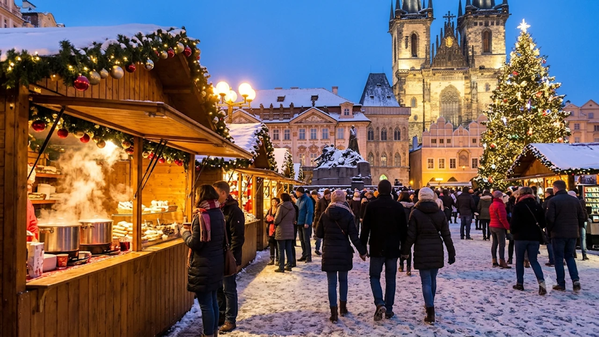

연말연시 낭만적인 크리스마스 마켓과 설경을 꿈꾸며 **2026 겨울 유럽 여행지**를 찾는 발걸음이 부쩍 늘었습니다. 올해 하반기부터 단계적으로 적용된 유럽 출입국 시스템 변화와 겨울철 현지 물가·교통 변수를 미리 짚어두어야 공항이나 역에서 발이 묶이는 일을 피할 수 있습니다. 실제 현지 동선과 바뀐 입국 규정을 반영해 올겨울 실패 없는 유럽 자유여행 핵심 가이드를 정리했습니다.

## 2026 겨울 유럽 여행지 추천 Top 5, 올해 꼭 가야 하는 이유

겨울 유럽은 여름 성수기 대비 숙박비 부담이 덜하고, 도시 전체가 화려한 조명으로 물드는 크리스마스 마켓 시즌을 만끽할 수 있어 매력적입니다. 특히 11월 중순부터 12월 말까지 유럽 주요 광장에서는 수공예품과 따뜻한 뱅쇼(글뤼바인)를 파는 대형 마켓이 일제히 문을 엽니다. 기차 이동 시간과 겨울철 기상 조건을 따져볼 때 아래 세 도시와 인근 근교 도시(독일 뉘른베르크, 스위스 취리히 포함)를 묶어 이동하는 일정이 효율적입니다.

### 오스트리아 비엔나: 클래식 크리스마스 마켓과 야경 명소

비엔나 시청사 앞 라트하우스 광장에서 열리는 크리스마스 마켓은 유럽에서도 손꼽히는 규모와 역사를 자랑합니다. 11월 중순 개장 직후에 찾으면 12월 극성수기 인파에 치이지 않고 야외 아이스링크와 대형 트리 조명을 여유롭게 감상할 수 있습니다. 칼바람이 부는 오전에는 벨베데레 궁전이나 미술사 박물관 같은 실내 코스를 둘러보고, 해가 지는 오후 4시 무렵 마켓으로 이동하는 동선이 체력을 아껴줍니다.

### 프랑스 스트라스부르: 유럽 최대 규모 크리스마스 수도 탐방

프랑스 알자스 지방의 스트라스부르는 '크리스마스의 수도'라는 별명답게 구시가지 골목 전체가 동화 속 마을처럼 꾸며집니다. 파리 동역에서 초고속 열차 TGV를 타면 약 1시간 50분 만에 닿아 파리 인아웃 일정에 1박 2일로 넣기 좋습니다. 건물 외벽에 매달린 대형 테디베어 장식과 30미터 높이의 클레베르 광장 트리는 이곳에서만 만날 수 있는 압도적인 풍경입니다.

### 체코 프라하: 눈 내리는 구시가지와 가성비 겨울 미식 여행

서유럽의 높은 외식 물가가 부담스럽다면 체코 프라하가 훌륭한 선택지입니다. 구시가지 광장의 천문시계탑과 틴 성당을 배경으로 펼쳐지는 마켓에서 갓 구운 굴뚝빵(뜨르들로)과 진한 체코 전통 수프를 합리적인 가격에 맛볼 수 있습니다. 눈이 소복이 쌓인 카를교의 새벽 풍경은 겨울 프라하 여행의 백미로 꼽히며, 기차로 2시간 거리인 독일 드레스덴 마켓과 연계하기도 수월합니다.

> **여행자 실전 팁:** 겨울 유럽은 오후 4시만 넘어도 사방이 어두워집니다. 야외 명소 사진 촬영과 마켓 구경은 오후 3시~6시 사이에 몰아서 끝내고, 저녁에는 미리 예약한 현지 레스토랑이나 클래식 공연을 즐기는 일정이 알찹니다.

## 2026년 11월부터 달라진 유럽 입국 및 현지 이동 핵심 체크리스트

올해 겨울 유럽 공항 입국장에서 가장 크게 체감되는 변화는 **유럽 출입국 시스템(EES)**의 본격 가동입니다. 여권에 잉크 도장을 찍어주던 기존 방식 대신, 비EU 국가 여행객의 얼굴 사진과 지문 등 생체 정보를 디지털로 등록하는 절차가 적용됩니다. 유럽 주요 허브 공항을 경유하거나 직항으로 들어갈 때 기존보다 심사 대기 줄이 길어질 수 있으므로 환승 시간을 넉넉히 잡아야 합니다.

### 유럽 출입국 시스템(EES) 생체 정보 등록 현장 대기 시간 줄이는 법

첫 입국 시 공항 내 셀프 키오스크에서 여권 스캔과 생체 정보 등록을 마친 뒤 입국 심사관 대면 절차를 거칩니다. 파리 샤를 드골 공항이나 프랑크푸르트 공항처럼 환승객이 몰리는 곳에서는 최소 3시간 이상의 환승 여유 시간을 확보해야 다음 비행기를 놓치지 않습니다. 최근 [미국 여행 입국 바뀐 규정 진짜 3가지](/posts/world-travel/us-travel-reentry-advance-parole-rule-change-2026/) 사례처럼 유럽 역시 디지털 생체 인증이 한층 까다로워졌으므로 출국 당일 공항 도착 시간을 평소보다 1시간 앞당기는 편이 안전합니다.

### 겨울철 유럽 주요 공항 결항·지연 대비 보상 규정 확인하기

11월 말부터 2월 사이 유럽 중·북부 지역은 폭설과 짙은 안개, 항공사 및 지상조업 노조 파업으로 항공편이 지연되는 일이 잦습니다. 유럽연합 출발 항공편이거나 EU 소속 항공사를 이용해 유럽으로 입국할 때 항공사 귀책 사유로 3시간 이상 지연되거나 결항되면 **EU261 규정**에 따라 운항 거리별 금전 보상을 청구할 수 있습니다. 악천후는 항공사 면책 사유에 해당하지만, 이 경우에도 항공사는 식사 바우처와 대체 항공편, 필요시 숙박을 제공할 의무가 있으므로 공항 카운터에서 지연 확인서를 반드시 챙겨야 합니다.

### 국가별 유레일 패스 및 도심 대중교통 모바일 앱 최신 이용법

유럽 주요 도시의 대중교통은 종이 티켓을 없애고 모바일 앱이나 비접촉식 카드 결제(컨택리스)로 빠르게 재편되었습니다. 비엔나의 'WienMobil', 프라하의 'PID Lítačka', 파리의 'Île-de-France Mobilités' 앱을 출국 전 한국에서 미리 설치하고 해외 결제가 되는 트래블 카드를 연동해 두면 매표소 앞에서 헤맬 일이 없습니다. 국가 간 이동 시 유레일 패스를 쓰더라도 인기 구간인 파리-스트라스부르, 빈-프라하 고속열차는 좌석 지정 예약이 필수이므로 출발 2~3주 전 앱에서 좌석을 선점해야 합니다.

## 겨울 유럽 여행 준비물 및 옷차림 완벽 가이드

겨울 유럽의 기온은 한국과 비슷하거나 약간 높지만, 습도가 높고 바람이 매서워 체감 추위가 훨씬 강합니다. 특히 구시가지의 울퉁불퉁한 돌바닥(코블스톤)은 눈이나 비가 내리면 빙판처럼 미끄러워 평범한 운동화를 신으면 발목을 삐끗하거나 발끝이 얼어붙기 쉽습니다.

### 영하권 기온과 돌바닥을 버티는 방한 신발 및 레이어드 코디 팁

- **신발 선택:** 접지력이 뛰어난 고무 밑창(비브람 솔 등)과 방수 기능이 있는 방한 부츠나 트레킹화를 신어야 젖은 돌바닥에서도 미끄러지지 않습니다.
- **레이어드 복장:** 두꺼운 패딩 하나만 걸치기보다 보온 내의, 경량 플리스, 방풍 외투를 겹쳐 입어야 난방이 뜨거운 실내 박물관이나 기차 안에서 땀이 식어 감기에 걸리는 일을 막을 수 있습니다.
- **보온 소품:** 귀를 덮는 니트 비니, 스마트폰 터치가 되는 방한 장갑, 목도리는 야외 크리스마스 마켓 대기 시간을 버티게 해주는 일등 공신입니다.

### 소매치기 예방을 위한 겨울철 외투·가방 보안 세팅법

두툼한 겨울 외투를 껴입으면 주머니나 가방에 타인의 손이 닿아도 감각이 둔해져 소매치기 표적이 되기 쉽습니다. 백팩은 반드시 앞으로 메거나 지퍼 고리에 카라비너를 걸어 한 번에 열리지 않도록 잠가두어야 합니다. 스마트폰은 스프링 스트랩을 연결해 외투 안쪽 주머니에 넣고, 여권 원본 대신 사본과 모바일 사진을 휴대하는 습관이 안전합니다. 계절별 인기 노선과 여행지 흐름은 [세계여행지 최신 트렌드](/posts/world-travel/world-travel-1783348391782/) 글에서도 함께 참고할 수 있습니다.

## 예산별·일정별 겨울 유럽 최적의 항공권 및 숙소 예약 전략

겨울 유럽 여행 경비를 가르는 핵심 변수는 항공권 발권 시점과 기차역·트램 정류장 인근 숙소 선점 여부입니다. 살을 에는 추위 속에 무거운 캐리어를 끌고 눈길 위를 15분 이상 걷는 일은 여행 초반부터 체력을 갉아먹으므로 숙소 위치에 예산을 우선 배분하는 편이 낫습니다.

### 직항 vs 경유 항공권 가격 비교 및 수하물 규정 주의사항

| 구분 | 직항 항공편 (인천 출발) | 1회 경유 항공편 (중동·유럽 허브) |
| :--- | :--- | :--- |
| **평균 왕복 요금 (11~12월)** | 130만 원 ~ 180만 원대 | 85만 원 ~ 125만 원대 |
| **총 소요 시간** | 약 12시간 ~ 14시간 | 약 16시간 ~ 20시간 |
| **추천 여행 일정** | 7일 이하 단기 일정, 부모님 동반 | 9일 이상 장기 일정, 가성비 중시 |
| **주의사항** | 비수기 특가 좌석 조기 마감 | 겨울철 경유지 기상 지연 및 수하물 분실 위험 |

경유 항공권을 끊을 때는 위탁 수하물이 최종 목적지까지 자동 연결(쓰루 배기지)되는지 발권 전 확인하고, 기내용 배낭에 최소 1~2일 치 속옷과 세면도구, 상비약을 따로 담아 수하물 지연 사고에 대비해야 합니다.

### 크리스마스 성수기 도심 접근성 좋은 숙소 선점 노하우

크리스마스 마켓이 열리는 11월 하순부터 12월 말까지는 주요 광장 도보 10분 이내 호텔 요금이 평소보다 30~50%가량 뜁니다. 예산을 아끼면서도 이동 편의성을 챙기려면 광장 한복판 대신 **중앙역(Hauptbahnhof) 인근이나 트램·지하철 직통 노선 역세권**의 3~4성급 비즈니스 호텔을 노리는 편이 유리합니다. 유럽의 오래된 건물은 중앙난방 가동 시간이 제한적이거나 외풍이 심한 곳이 많으므로 예약 전 투숙객 후기에서 '난방(Heating)'과 '온수(Hot water)' 관련 평가를 꼼꼼히 따져보아야 합니다.

영하의 유럽 현지에서 스마트폰 배터리 급속 방전과 체온 저하를 동시에 막으려면 대용량 보조배터리와 휴대용 손난로, 도난 방지 크로스백을 출국 전 미리 챙겨두는 편이 좋습니다.

[유럽 겨울여행 방한용품 및 도난방지가방 쿠팡에서 보기](https://www.coupang.com/np/search?q=%EC%9C%A0%EB%9F%BD+%EA%B2%A8%EC%9A%B8%EC%97%AC%ED%96%89+%EC%A4%80%EB%B9%84%EB%AC%BC&sourceType=affiliate&trackingCode=AF8691300)

#2026겨울유럽여행지 #유럽크리스마스마켓 #유럽입국규정 #유럽EES #비엔나여행 #스트라스부르 #프라하겨울여행 #유럽여행준비물 #겨울유럽옷차림 #유럽자유여행