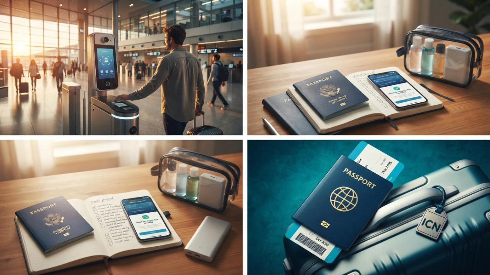

2026 연말 해외여행 성수기가 코앞으로 다가오면서 인천공항 출국장과 해외 주요 공항의 수속 흐름이 한층 촘촘해졌다. 스마트패스 안면 인식과 현지 생체인증 입국 절차가 빠르게 자리 잡는 동시에 보안검색 기준도 까다로워져 예전 감각대로 공항에 나갔다간 탑승구 앞에서 진땀을 빼기 십상이다. 연말 출국길 대기 시간을 아끼기 위해 바뀐 수속 핵심과 현장 대처법을 정리한다.

## 2026 연말 해외여행 출국 수속 주요 변경 사항

### 인천공항 스마트패스 및 자동출입국심사 확대 적용
인천공항 제1·제2여객터미널에서는 여권과 얼굴 정보를 앱에 미리 연동해 전용 통로로 진입하는 **스마트패스** 적용 게이트가 늘었다. 다만 자동출입국심사 등록을 마친 여행자라도 신규 장비가 설치된 구역에서는 안면 인식이나 지문 확인을 한 번 더 거치는 경우가 잦다. 성수기 오전 피크 시간대에는 스마트패스 전용 라인과 일반 출국장 대기 길이가 수시로 역전되므로 출국장 진입 직전 두 줄의 실제 대기열을 눈으로 비교해 선택하는 편이 빠르다.

### 해외 주요 공항 생체인증 입국 절차 도입 현황
미국, 유럽, 일본 등 주요 여행지 공항은 입국심사대에 **생체인증** 키오스크와 자동 게이트를 확대 배치했다. 자동 게이트를 통과하더라도 단기 체류 목적 확인이나 무작위 선별에 걸리면 유인 심사대로 이동해야 한다. 입국심사관 질문에 막힘없이 답하려면 숙소 바우처, 귀국 항공권 일정, 체류 주소를 휴대폰에 오프라인 PDF로 저장해 두는 것이 안전하다. 앞서 정리한 [미국 여행 입국 바뀐 규정 진짜 3가지](/posts/world-travel/us-travel-reentry-advance-parole-rule-change-2026/)처럼 방문국별 세부 입국 조건 변화도 출발 전 함께 대조해야 한다.

### 연말 성수기 수하물 규정 및 보안검색 강화 품목
연말에는 선물용 가공식품, 대용량 보조배터리, 액체류 화장품 때문에 **보안검색** 컨베이어벨트에서 가방이 2차 개장 검사로 빠지는 사례가 속출한다. 기내 반입 기준을 지켰더라도 보조배터리와 충전 케이블이 파우치 없이 가방 바닥에 뒤엉켜 있으면 X선 판독 시간이 길어진다. 위탁수하물 역시 저비용항공사와 대형항공사 간 무료 허용 무게 및 초과 요금 체계가 판이하므로 발권 직후 항공사 규정 페이지에서 수하물 규격을 재확인해야 한다.

## 출발 전 필수 체크리스트와 사전 등록 방법

### 출국 48시간 전 모바일 앱 사전 등록 절차
출국 이틀 전부터는 항공사 앱에서 **온라인 체크인**과 좌석 지정, 모바일 탑승권 발급을 먼저 끝낸다. 위탁 짐이 있더라도 모바일 탑승권을 미리 받아 두면 수하물 전용 백드롭 카운터로 바로 이동해 줄 서는 시간을 크게 줄일 수 있다.

- 여권 유효기간이 방문 국가 요구 기준(통상 6개월 이상)을 충족하는지 확인
- 항공사 앱 로그인 후 예약 번호와 영문 성·이름 철자 일치 여부 점검
- 인천공항 스마트패스 앱에 여권 스캔 및 얼굴 사진 사전 등록 완료
- 비상 연락망과 여행자보험 증권 번호를 휴대폰 메모장에 오프라인 저장

### 전자여행허가 및 온라인 세관신고서 작성 요령
목적지에 따라 전자여행허가 또는 온라인 세관·검역 신고서를 출발 전 미리 제출해야 현지 공항 입국장에서 종이 서류를 적느라 시간을 버리지 않는다. 검색 상단에 노출되는 사설 대행 사이트에서 불필요한 수수료를 결제하지 않으려면 각국 정부 공식 도메인 주소인지 반드시 확인한다. 신고서 작성 시에는 현금 반입 한도, 면세 초과 구매품, 육류가공품이나 과일류 반입 여부를 사실대로 기재한다.

### 공항 도착 권장 시간과 터미널별 혼잡도 확인법
연말 성수기에는 평일 오전 7~9시와 주말 오전 시간대에 출국장 및 수하물 위탁 대기열이 순식간에 불어난다. 국제선 출발 최소 3시간 전 공항 도착을 기본으로 잡되, 연말 연휴 직전 주말이라면 3시간 30분 전 도착을 권한다. 출발 당일 집을 나서기 전 인천공항 공식 앱에서 **출국장별 예상 혼잡도**와 이용 항공사 체크인 카운터 구역을 확인하면 불필요한 터미널 내 이동을 막을 수 있다.

## 주요 행선지별 공항 대기 시간 및 대처 전략

### 일본·동남아 단거리 노선 피크 시간대 비교
도쿄, 오사카, 후쿠오카 등 일본 노선과 방콕, 다낭, 싱가포르 등 동남아 노선은 연말 짧은 연차를 활용한 여행객이 한꺼번에 몰린다. 오전 8~10시 사이 출발 편이 집중되는 시간대에는 체크인 카운터부터 면세품 인도장까지 병목현상이 잦다. 단거리 노선일수록 기내 수하물 무게를 게이트 앞에서 저울로 재는 항공사가 많으므로 백팩과 캐리어 합산 무게를 미리 맞춰 두는 편이 낫다. 현지 추가 지출 흐름은 [일본 JR패스 기습 인상 및 소도시 숙박세 연쇄 도](/posts/world-travel/world-travel-issue-20261008/)에서 다룬 체류 비용 변화와도 맞물린다.

### 유럽·미주 장거리 노선 환승 및 보안검색 주의점
유럽과 미주 노선은 장거리 일정 특성상 수하물 부피가 크고 경유 항공편을 택하는 비중이 높다. 환승 공항에서는 연결편 탑승 게이트까지의 이동 시간과 터미널 간 셔틀 탑승 여부를 미리 파악해 두어야 환승 실패를 피할 수 있다.

> 장거리 노선에서는 기내 반입 배낭에 보조배터리, 처방약, 하루 치 여벌 옷, 귀중품을 분리 수납해 두면 위탁수하물 도착이 지연되더라도 현지 첫날 일정을 무리 없이 소화할 수 있다.

### 항공편 지연·결항 발생 시 현장 대응 매뉴얼
겨울철 폭설이나 항공기 연결 지연으로 출발 시각이 밀리면 공항 내 항공사 카운터 줄에 서기 전에 항공사 공식 앱과 고객센터 전화로 대체편 좌석부터 선점한다. 지연·결항 확인서는 여행자보험 특약 청구나 숙박·교통비 증빙에 필수 서류로 쓰이므로 현장 데스크나 이메일로 반드시 발급받아 둔다.

## 연말 성수기 공항 이용 실전 절약 및 편의 팁

### 패스트트랙 및 교통약자 우대 출국장 이용 조건
만 70세 이상 고령자, 만 7세 미만 유아 동반 가족, 임산부, 보행이 불편한 승객 등 교통약자 우대 대상에 해당한다면 전용 출국장 이용 자격을 미리 확인한다. 우대 승객 본인과 동반 가능한 가족 인원수 제한이 공항 안내 기준에 따라 정해져 있으므로 출국장 입구 안내 데스크에서 여권과 탑승권을 제시해 패스를 발급받으면 대기 시간을 대폭 줄일 수 있다.

### 공항 라운지·수하물 배송 서비스 활용 가이드
연말 성수기에는 제휴 신용카드 라운지도 입장 대기 줄이 길어지므로 카드사 앱에서 전월 실적 충족 여부와 라운지 이용 가능 시간대를 출발 전 확인한다. 공항 이동 전후 무거운 캐리어를 끌고 다니는 피로를 줄이고 싶다면 자택에서 공항으로, 또는 현지 공항에서 숙소로 짐을 먼저 보내는 **수하물 배송 서비스**를 사전 예약해 두는 편이 효율적이다.

[기내 보조배터리 파우치 쿠팡에서 보기](https://www.coupang.com/np/search?q=%EA%B8%B0%EB%82%B4%20%EB%B3%B4%EC%A1%B0%EB%B0%B0%ED%84%B0%EB%A6%AC%20%ED%8C%8C%EC%9A%B0%EC%B9%98&sourceType=affiliate&trackingCode=AF8691300)

#2026년연말해외여행 #인천공항출국수속 #스마트패스 #자동출입국심사 #해외여행준비물 #공항보안검색 #연말여행팁