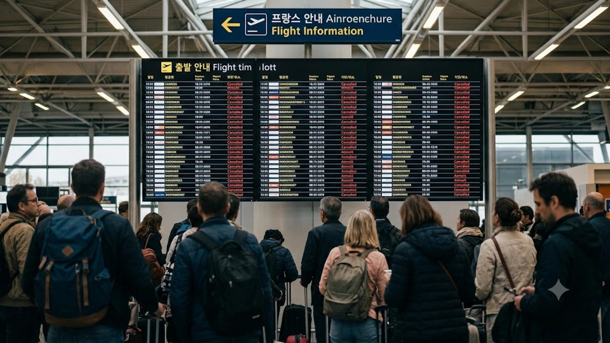

프랑스 주요 공항을 통한 가을 유럽 여행을 앞두고 있다면 비행기 운항 일정 점검을 서둘러야 합니다. 프랑스 주요 5개 항공 노동조합이 정부 정책에 반발해 총파업에 돌입하면서 대규모 비행기 결항 사태가 눈앞으로 다가왔습니다. 이번 **프랑스 항공 파업** 여파로 파리 노선뿐만 아니라 샤를 드골 공항을 경유하는 유럽 전역의 연결편까지 줄줄이 멈춰 설 조짐을 보이고 있습니다.

## 10월 프랑스 항공 5일 총파업 일정 및 영향 노선 분석

### 10월 17일~21일 파업 돌입 배경과 파리 주요 공항 마비 가능성
프랑스 조종사 및 객실 승무원 노조 연대는 정부의 연금 개편 및 근무 조건 개정에 반대하며 2026년 10월 17일 0시부터 10월 21일 23시 59분까지 총 5일간 전면 업무 중단을 결의했습니다. 파리의 관문인 **샤를 드골 공항(CDG)**과 **오를리 공항(ORY)**을 비롯해 니스, 리옹, 마르세유 등 주요 거점 공항이 직접적인 타격을 입게 됩니다.

프랑스 민간항공청(DGAC)은 파업 기간 중 안전 기준 충돌을 방지하고자 각 항공사에 일일 운항 편수를 최대 30~50%까지 사전 감축할 것을 권고한 상태입니다. 공항 관제탑과 지상 조업 인력까지 파업 지지 대열에 가세하면서 출발 지연은 물론 주기장 배정 지연에 따른 기내 대기 시간 폭증이 현실화하고 있습니다.

### 에어프랑스 및 유럽 경유 노선의 예상 지연·결항 규모
국적사인 **에어프랑스(Air France)**는 장거리 대륙 간 노선의 운항률을 약 70% 수준으로 방어하겠다고 발표했으나, 파리를 기점으로 런던, 로마, 바르셀로나 등을 잇는 중·단거리 유럽 역내 노선은 절반 가까이 결항될 위기에 직면했습니다.

루프트한자, 영국항공, KLM 등 타국 항공사 역시 프랑스 영공을 통과하거나 파리에 착륙하는 노선 운항을 대폭 축소하고 있습니다. 파리를 거쳐 최종 목적지로 향하는 환승 일정을 짰다면 첫 탑승편이 정상 출발하더라도 파리 현지 환승 게이트에서 발이 묶이는 위험이 큽니다.

## 내 비행기표 결항 여부 실시간 확인법 및 항공사별 무료 변경 규정

### 출발 24~48시간 전 항공편 상태 추적 및 항공사 알림 설정법
항공권 예약 사이트(OTA)나 구매 대행사 안내는 실시간 현장 변동을 즉각 반영하지 못합니다. 반드시 탑승 예정 항공사 공식 모바일 애플리케이션에 전자항공권(e-티켓) 예약 번호를 등록하고 푸시 알림과 SMS 수신을 켜두어야 합니다.

> **항공편 실시간 상태 추적 팁:** 항공사 공지보다 항공기 위치 추적 플랫폼(Flightradar24 등)에서 전편(Inbound flight)의 출발 여부를 직접 조회하는 편이 운항 취소 여부를 3~4시간 더 빠르게 감지하는 방법입니다.

비행기 편명이 '확정 취소(Cancelled)'로 전환되는 순간 즉각 대체편 선택 화면이 열리므로 실시간 모바일 접속 환경을 사전에 갖춰야 합니다.

### 항공사 귀책 결항 시 전액 환불 및 수수료 없는 여정 변경 신청 절차
항공사가 파업으로 인해 운항을 취소하거나 5시간 이상 일정을 지연시킬 경우 승객은 두 가지 선택권을 갖습니다. 위약금 없는 **전액 환불(Full Refund)**을 요구하거나, 추가 비용 없는 **대체 항공편(Rebooking)**을 요청할 권리입니다.

- **온라인 셀프 변경 활용:** 콜센터 통화 대기자가 수천 명으로 몰리므로 항공사 앱 내 'Manage Booking(예약 관리)' 메뉴에서 무료 변경 가능한 잔여 좌석을 직접 선택하는 편이 유리합니다.
- **날짜 변경 유연성:** 통상 파업 공식 기간 전후 7일 이내의 날짜로 수수료 없는 일정 이동을 허용하므로 여행 일정을 유연하게 당기거나 늦추는 결단이 필요합니다.

### 유럽연합 EU261 승객 권리 규정 적용 여부와 보상금 청구 조건
유럽 연합 규정인 **EU261/2004**에 따르면 유럽 내 공항에서 출발하거나 EU 국적 항공사를 이용해 EU로 입국할 때 항공사 귀책으로 결항·3시간 이상 지연 시 비행 거리에 따라 250유로에서 최대 600유로까지 정액 보상금을 지급받을 수 있습니다.

단, 항공사들은 자체 승무원 파업을 '통제 불가능한 비상 상황(Extraordinary Circumstances)'으로 주장하며 지급을 거부하려는 경향을 보입니다. 유럽사법재판소(ECJ) 판례는 사내 노동쟁의를 항공사의 통제 범위 내 사건으로 해석해 배상 책임을 인정하는 추세이므로, 결항 확인서와 탑승권 실물 사진을 철저히 보관해 추후 보상 대행이나 정식 클레임을 제기해야 합니다. 유럽 내 국가별 출입국 변동 사항이 잦은 시기이므로 [세계여행지 최신 트렌드](/posts/world-travel/world-travel-1783348391782/)를 함께 확인하며 전체 일정의 규정을 조율하는 편이 안전합니다.

## 프랑스 입국·이동 차질 막는 3대 대체 교통편 우회 전략

### 유로스타 및 프랑스 테제베 육로 이동 티켓 확보 노하우
파리행 비행기가 취소되었다면 철도망을 이용한 육로 우회로 눈을 돌려야 합니다. 런던 세인트 팬크러스 역에서 출발하는 **유로스타(Eurostar)**나 벨기에 브뤼셀에서 파리로 향하는 고속철도는 파업 선언 직후 잔여석이 빠르게 소진됩니다.

철도 파업이 동반되지 않는 한 프랑스 국철(SNCF)의 **테제베(TGV)**는 파리 외곽 도시와 수도권을 촘촘히 잇는 핵심 대안입니다. SNCF Connect 앱을 통해 오전 이른 시간이나 심야 시간대 잔여 좌석 알림을 걸어두고, 취소표 발생 즉시 결제할 수 있도록 결제 수단을 미리 등록해 둡니다.

### 브뤼셀·암스테르담 등 인접국 공항 경유 후 육로 진입 루트 비교
한국에서 출발하는 여정이라면 파리 직항 대신 벨기에 브뤼셀(BRU), 네덜란드 암스테르담(AMS), 독일 프랑크푸르트(FRA) 공항으로 목적지를 긴급 변경하는 방안을 고려해야 합니다.

- **브뤼셀 공항 착륙 루트:** 브뤼셀 미디(Midi) 역에서 파리 북역(Gare du Nord)까지 고속열차로 약 1시간 25분이면 주파할 수 있어 이동 손실이 가장 적습니다.
- **암스테르담 스키폴 공항 루트:** 고속열차로 파리까지 약 3시간 20분이 소요되며, 항공편 공급이 풍부해 직항 대체편을 구하기 수월합니다.
- **취리히 또는 제네바 경유 루트:** 프랑스 남부나 동부 지역으로 이동할 때 유용한 선택지입니다.

### 플릭스버스 및 장거리 렌터카 예약 시 주의할 체크리스트
고속철도마저 매진되었다면 유럽 전역을 잇는 장거리 버스 플랫폼인 **플릭스버스(FlixBus)**와 **블라블라카 버스(BlaBlaCar Bus)**가 실질적인 비상 탈출구가 됩니다. 

렌터카를 대여해 국경을 넘어 파리로 진입할 계획이라면 국가 간 이동(Cross-border) 허용 조항이 계약서에 포함되었는지 확인해야 합니다. 파리 시내 진입 시 차량 배출가스 등급 스티커인 '크리테르(Crit'Air)' 미부착 차량은 68유로 상당의 과태료 처분을 받을 수 있으므로 프랑스 등록 차량인지 대여 창구에서 확인해야 합니다.

## 파업 직격탄 대비 여행자보험 보상 기준과 현장 대처 행동 요령

### 항공기 결항·지연 담보 여행자보험 청구에 필요한 핵심 증빙 서류
국내 여행자보험 가입 시 포함된 '항공기 결항/지연 특별약관'은 대개 4시간 이상 지연 또는 결항 확정 시 발생하는 식음료비, 공항 인근 호텔 숙박비, 통신비, 필수 세면도구 구입 비용을 보장 한도(통상 20만~50만 원) 내에서 실비 보상합니다. 보험금 청구를 위해서는 현장에서 증빙 서류를 빠짐없이 챙겨야 합니다.

- 항공사 카운터에서 발급한 날짜·편명·결항 사유(파업 표기)가 명시된 **결항 증명서(Irregularity Report)**
- 대체편 발권 내역이 기재된 원본 및 신규 **탑승권(Boarding Pass)**
- 대기 시간 동안 지출한 모든 카드 결제 영수증(상호명, 품목, 시간대 확인 필수)

### 공항 현장 장시간 대기 시 식사·숙박 바우처 요구 및 영수증 관리법
결항이 발생한 공항 카운터에서 항공사 직원에게 대기 시간 동안 사용할 식사 쿠폰(Meal Voucher)과 당일 숙박이 불가능할 경우 제공하는 호텔 바우처를 요구할 수 있습니다. 

항공사가 현장 혼잡을 이유로 바우처를 지급하지 못한다고 안내할 때는 "자비로 결제 후 사후 영수증 청구가 가능한지" 직원의 영문 답변을 메모하고, 해당 영수증을 분실하지 않도록 모바일 카메라로 즉시 스캔해 두어야 합니다.

### 파업 일정 장기화 대비 현지 숙소 및 투어 예약 무료 취소 방안
항공편 파업으로 목적지에 도착하지 못했을 때 호텔스닷컴, 아고다, 에어비앤비 등 숙박 예약 플랫폼은 환불 불가 조건이라도 예외 환불을 중재하는 경우가 있습니다. 

비행기 결항 증명서를 PDF 파일로 첨부해 숙소 호스트와 플랫폼 고객센터에 "천재지변 및 항공사 불가항력적 파업으로 인한 노쇼(No-show)"임을 알리고 예약 취소 또는 일정 무료 변경을 요청해야 합니다. 루브르 박물관, 오르세 미술관 등 현지 투어 상품 역시 파업 사실을 기재한 결항 서류를 접수하면 수수료 없이 바우처 취소가 가능한 경우가 많습니다.

비행기 지연과 공항 대기로 긴 시간 이동해야 할 때는 [기내용 압축파우치 쿠팡에서 보기](https://www.coupang.com/np/search?q=%EC%97%AC%ED%96%89%EC%9A%A9%ED%92%88&sourceType=affiliate&trackingCode=AF8691300)를 통해 짐 부피를 줄이고 필수 소지품을 기내 가방에 분리 보관하는 편이 혼잡한 공항 환승 과정에서 안전합니다.

#프랑스항공파업 #에어프랑스결항 #샤를드골공항 #비행기결항환불 #유럽항공권지연 #유로스타대체이동 #EU261보상금 #여행자보험결항청구