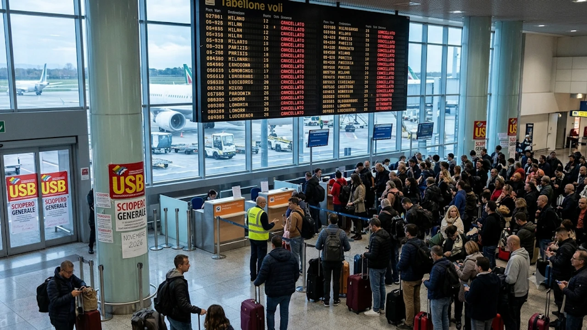

**2026년 11월 이탈리아 파업** 여파로 현지 하늘길과 철도망 전반에 비상이 걸렸습니다. 11월 중순부터 하순까지 이어지는 연속 총파업과 나폴리 공항 활주로 폐쇄가 겹치면서, 여행객들은 **항공권 결항 및 지연 대처법**과 대체 이동 경로를 미리 확보해야 합니다. 유럽 항공승객 권리 규정(EC 261)을 활용한 환불 기준부터 현장 우회 전략까지 실전 대응법을 정리했습니다.

## 2026년 11월 이탈리아 3일 연속 총파업과 공항 폐쇄 일정 총정리

이탈리아 교통부와 주요 노동조합(USB, Cub 등) 공지에 따르면 2026년 11월에는 도심 대중교통부터 항공 관제까지 전방위적인 파업이 집중되어 있습니다.

### 11월 13일 베니스·밀라노 지상 교통 파업과 공항 이동 주의사항

11월 13일에는 베니스 수상버스(ACTV)와 밀라노 리나테 공항 지상 조업 직원들이 24시간 파업에 돌입합니다. 이 기간 베니스 본섬과 마르코 폴로 공항을 오가는 수상 택시 및 버스 배차가 급감합니다. 특히 수상 도시의 특성을 고려해 [베네치아 당일치기 300유로 벌금 피하는 법](/posts/world-travel/venice-day-trip-entry-fee-qr-fine-guide/)과 함께 도보 및 사설 수상 이동편을 미리 확인해 두는 편이 안전합니다.

### 11월 20일~22일 이탈리아 전국 총파업 및 관제사·보안요원 파업 시간표

가장 타격이 큰 시기는 **11월 20일부터 22일까지 이어지는 3일 연속 총파업**입니다.
- **11월 20일:** 이탈리아 전국 공공·민간 부문 총파업 (철도 노조 합류 시 열차 운행 중단)
- **11월 21일:** 주요 공항 항공 관제사 및 보안 검색 요원 부분 파업 (오전 10시~오후 6시 집중)
- **11월 22일:** 국영 철도(트레니탈리아) 및 지역 버스 노조 연장 파업

> 이탈리아 민간항공청(ENAC) 규정상 파업 당일에도 **오전 7시~10시, 오후 6시~9시** 사이에는 필수 항공편(Guaranteed Flights) 운항이 보장됩니다. 항공편을 예약하거나 변경할 때 해당 시간대 출발편을 우선 선점해야 결항 위험을 피할 수 있습니다.

### 11월 한 달간 나폴리 공항 활주로 공사로 인한 로마·살레르노 대체 운항 안내

남부 이탈리아 거점인 **나폴리 카포디키노 국제공항**은 노후 활주로 전면 재포장 공사로 인해 11월 내내 정상 운영이 제한됩니다. 이지젯(easyJet), 라이언에어 등 주요 저비용 항공사들은 나폴리행 노선을 **로마 피우미치노 공항**이나 인근 **살레르노 코스타 다말피 공항**으로 우회 편성해 운항 중입니다.

## 유럽 11월 연쇄 파업 현황 비교 분석 (이탈리아 vs 스페인·포르투갈)

2026년 11월은 이탈리아뿐만 아니라 남유럽 주요 국가들에서 동시다발적으로 운송 노조 쟁의가 발생하며 유럽 내 환승 일정에 연쇄 지연을 일으키고 있습니다.

### 11월 11일 스페인 24시간 총파업 여파와 철도·항공 지연 현황

스페인에서는 지난 11월 11일 철도 및 항공 지상조업 노조가 24시간 총파업을 단행했습니다. 마드리드 바라하스 공항과 바르셀로나 엘프라트 공항을 경유해 이탈리아로 입국하는 연결 항공편의 경우, 수하물 상하역 지연과 기체 연결 문제로 연쇄적인 스케줄 변동이 이어지고 있습니다.

### 연말까지 이어지는 포르투갈 아조레스 제도 지상조업 초과근무 거부 영향

포르투갈에서는 아조레스 제도 공항 지상 조업 직원들이 연말까지 초과근무 및 휴일 근무 거부를 선언했습니다. 본토인 리스본이나 포르투에서 출발하는 대서양 횡단 노선 및 환승편의 수하물 처리 속도가 평소보다 크게 떨어진 상태입니다.

### 여행지별 항공·철도 타격 강도 및 일정 변경 우선순위 비교

| 국가 및 지역 | 파업·제한 일정 | 주요 타격 수단 | 일정 변경 우선순위 |
| :--- | :--- | :--- | :--- |
| **이탈리아 전국** | 11월 20일~22일 | 항공 관제, 고속철도, 시내버스 | **최우선** (도시간 이동 최소화) |
| **이탈리아 나폴리** | 11월 전체 (활주로 공사) | 국내선·단거리 국제선 항공 | **높음** (로마 인아웃으로 변경) |
| **스페인 주요 도시** | 11월 11일 이후 여파 지속 | 철도(Renfe), 공항 수하물 | **보통** (환승 여유 4시간 이상 확보) |
| **포르투갈 아조레스** | 2026년 연말까지 | 도서 지역 연결 항공편 | **낮음** (기내 수하물 위주 탑승) |

## 파업으로 인한 항공권 결항·지연 시 승객 권리와 보상 기준

유럽 출발 항공편이나 유럽 국적기를 이용하는 경우, 파업 주체에 따라 금전적 보상 여부가 명확하게 갈립니다.

### 유럽 항공승객 권리 규정(EC 261) 적용 여부 및 '특별한 사정' 예외 기준

유럽연합(EU) 규정인 **EC 261/2004**에 따라 항공편 결항이나 3시간 이상 지연 시 비행 거리에 비례해 250~600유로의 현금 보상을 청구할 수 있습니다. 하지만 **공항 관제사나 보안 검색 요원 파업**은 항공사가 통제할 수 없는 '특별한 사정(Extraordinary Circumstances)'으로 분류되어 현금 보상 대상에서 제외됩니다. 반면 **항공사 자체 조종사·승무원 파업**으로 결항된 경우에는 현금 보상을 당당히 요구할 수 있습니다.

### 항공사 무료 일정 변경, 전액 환불, 식사·숙박 지원 요청 튜토리얼

현금 보상과 무관하게 항공사는 승객에게 기본 보호 의무를 제공해야 합니다. 결항 통보를 받았다면 공항 카운터 줄에 서기 전 아래 순서대로 움직이세요.

1. **항공사 앱 접속 및 대체편 선점:** 공항 현장 대기열은 기본 3~4시간이 걸리므로 공식 앱에서 무료 날짜 변경 또는 동일 목적지 대체 항공편을 먼저 확정합니다.
2. **전액 환불 신청:** 여행 자체를 취소할 경우 미사용 구간에 대한 수수료 없는 전액 환불을 요청합니다.
3. **체류 비용 지원 요청:** 대체편 탑승까지 밤을 새워야 한다면 항공사 데스크에 호텔 숙박권과 식사 바우처를 요구하고, 자비로 결제했을 때는 영수증을 모두 보관해 사후 청구합니다.

### 여행자 보험 특약 활용법과 공항 내 증빙 서류 확보 절차

국내에서 가입한 해외여행자보험에 **'항공기 및 수하물 지연 비용(결항 포함)'** 특약이 있다면, 4시간 이상 지연 시 발생한 식사비, 라운지 이용료, 숙박비를 한도 내에서 돌려받을 수 있습니다. 청구를 위해서는 항공사 데스크에서 발급한 **결항·지연 확인서(Delay/Cancellation Certificate)**와 대체 항공편 보딩패스, 현지 카드 영수증을 반드시 챙겨야 합니다.

## 이탈리아 파업 기간 실제 여행자를 위한 현장 대응 및 우회 전략

파업 기간 중 현지에 체류하고 있다면 대중교통 의존도를 낮추고 물리적인 이동 시간을 넉넉히 배분해야 일정을 지킬 수 있습니다.

### 파업 당일 공항 조기 도착 및 사설 셔틀·택시 사전 예약 노하우

보안 검색 인력 파업이 겹치는 날에는 출국장 진입에만 2시간 이상 걸립니다. 국제선은 **출발 4시간 전**, 유럽 역내선은 **3시간 전** 공항에 도착하도록 일정을 잡으세요. 파업 당일에는 우버(Uber)나 일반 택시 호출이 마비되므로, **프리티나우(FreeNow)** 앱 예약 기능이나 호텔 컨시어지를 통해 전날 미리 픽업 차량을 확정해 두어야 합니다.

### 국영 철도(트레니탈리아) 파업 시간대 피하는 대체 이동 루트

국영 철도인 트레니탈리아(Trenitalia)가 파업에 들어가더라도 민영 고속철도인 **이딸로(Italo)**는 정상 운행하거나 감축 운행 비율이 낮은 편입니다. 열차 전체가 멈추는 최악의 상황에는 **플릭스버스(FlixBus)**나 **이타버스(Itabus)** 같은 시외버스 노선을 이용하면 로마·피렌체·밀라노 등 주요 거점 도시 간 이동을 이어갈 수 있습니다.

### 나폴리·아말피 해안 여행객을 위한 로마 피우미치노 공항 환승 팁

나폴리 공항 폐쇄 기간 중 남부 지역을 방문한다면 로마 피우미치노 공항으로 입국한 뒤 기차로 이동하는 경로가 가장 안정적입니다. 공항역에서 레오나르도 익스프레스를 타고 로마 테르미니역으로 이동한 후, 고속열차(프레치아로사 또는 이딸로)로 환승하면 나폴리 중앙역까지 약 1시간 10분 만에 닿습니다. 공항 대기 시간이 길어지면서 항공편 변경과 숙소 예약을 스마트폰으로 계속 처리해야 하므로, 기내 반입이 가능한 대용량 보조배터리를 미리 챙겨 방전에 대비하세요.

[기내용 대용량 고속충전 보조배터리 쿠팡에서 보기](https://www.coupang.com/np/search?q=%EA%B8%B0%EB%82%B4%EC%9A%A9+%EB%B3%B4%EC%A1%B0%EB%B0%B0%ED%84%B0%EB%A6%AC&sourceType=affiliate&trackingCode=AF8691300)

#2026년이탈리아파업 #이탈리아총파업 #이탈리아항공권결항 #유럽항공권환불 #EC261보상 #나폴리공항폐쇄 #이탈리아여행준비 #유럽파업대처법