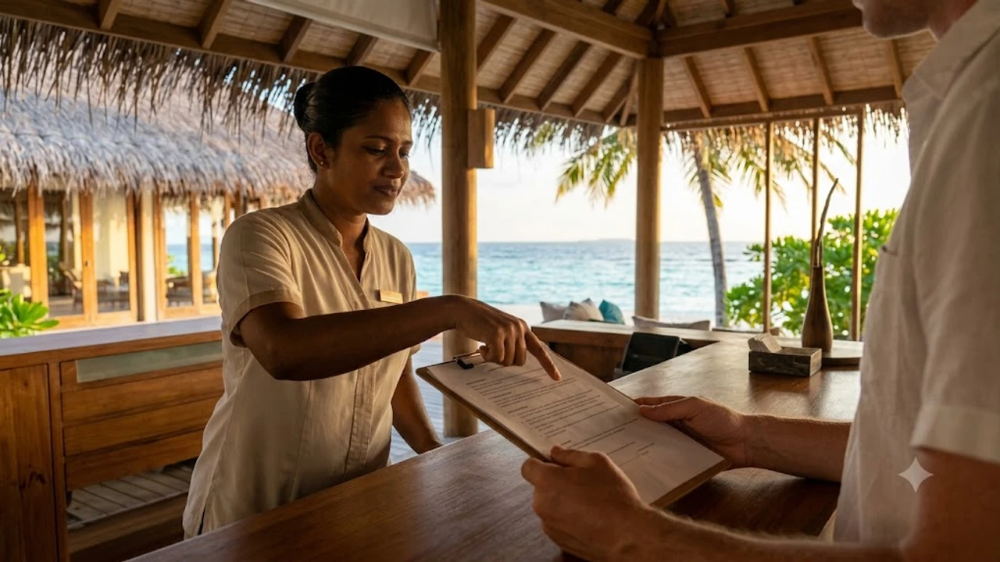

몰디브 여행을 준비하던 예비 신혼부부와 자유 여행객들의 간담을 서늘하게 만들었던 해외 예약 플랫폼 과세 이슈가 극적으로 일단락되었습니다. 몰디브 세무당국이 밀어붙이던 17% 원천징수 카드를 공식적으로 거둬들이면서, 숙박비 폭등을 걱정하던 여행자들 사이에서 **몰디브 세금 인상 유예** 조치의 실제 적용 기준과 **리조트 예약 비용** 변동 폭에 이목이 쏠립니다. 올가을과 다가오는 겨울 성수기 일정을 확정하기 전, 이번 결정이 내 손에 쥐어질 최종 견적서에 어떤 차이를 만들어내는지 명확한 팩트를 짚어낼 필요가 있습니다.

## 몰디브 17% 관광세 부과 전격 유예 배경과 핵심 발표

### 정부 발표로 멈춘 리조트 요금 폭탄
몰디브 세무당국(MIRA)은 글로벌 온라인 여행 플랫폼(OTA)과 해외 여행사에 징수하려던 17%의 비거주자 원천세(Non-Resident Withholding Tax) 시행일을 **2027년 4월 1일**까지 전격 연기한다고 못 박았습니다. 몰디브 리조트 연합인 호텔관광협회(MATI)와 글로벌 여행 기업들이 "가뜩이나 비싼 몰디브 여행 수요가 인근 동남아 휴양지로 대거 이탈할 것"이라며 연일 강력하게 항의하자, 겨울 성수기를 코앞에 두고 결국 백기를 든 셈입니다.

> **MIRA 공식 유예 결정 핵심:** 해외 플랫폼 및 여행사를 통해 결제되는 숙박 거래에 대한 17% 원천세 징수가 2027년 1분기 말까지 일괄 보류되며, 기존 세금 정산 체계가 그대로 유지됩니다.

최근 전 세계 인기 여행지들이 오버투어리즘 억제나 세수 확충을 명분 삼아 관광세를 줄줄이 인상하는 형국입니다. 유럽 현지에서 [베네치아 당일치기 300유로 벌금 피하는 법](/posts/world-travel/venice-day-trip-entry-fee-qr-fine-guide/)처럼 강력한 통제 정책이 현실화하는 추세와 비교하면, 몰디브의 이번 속도 조절은 여행자 입장에서 천금 같은 비용 방어 기회로 작용합니다.

### 2026년 가을부터 적용 예정이었던 추가 과세의 실체
원래 추진안의 뼈대는 아고다, 부킹닷컴, 익스피디아 같은 해외 플랫폼이나 한국 여행사가 몰디브 현지 리조트에 대금을 정산할 때 송금액의 17%를 세금으로 원천 징수하는 구조였습니다.

- **숙박비 전가 구조:** 수수료 마진율이 한 자릿수에 불과한 OTA 플랫폼과 여행사 구조상 17%에 달하는 세금을 떠안는 것은 불가능하므로, 고스란히 소비자 판매가에 얹어질 수밖에 없는 상태였습니다.
- **체감 요금 폭등:** 1박에 150만 원 수준인 중상위권 워터빌라 4박 예약 시, 기존 세금에 더해 순수 세금 명목으로만 100만 원 안팎의 묵직한 추가 지출이 얹어질 뻔한 위기였습니다.
- **유예 확정의 결과:** 추가 과세 카드가 유예되면서 여행자들의 숨통을 조이던 15~20% 수준의 기습 객실 요금 인상 요인이 단숨에 사라졌습니다.

## 기존 예약자와 신규 예약자별 요금 청구 시나리오

### 이미 결제를 마친 여행객: 추가 청구 걱정 끝
이미 2026년 하반기나 2027년 초 일정을 확정 짓고 바우처를 수령한 여행객은 현지 체크인 데스크에서 뜬금없는 세금 폭탄을 마주할 위험에서 완전히 벗어났습니다.

일부 리조트가 약관 구석에 '현지 법령 개정에 따른 세금 인상분 사후 청구 가능' 문구를 적어두며 여행자들을 긴장시켰으나, 세법 시행 자체가 2027년 4월로 미뤄진 만큼 법적 청구 근거 자체가 사라졌습니다. 예약 확정서를 이미 손에 쥐었다면 여행사나 숙소 측으로부터 세금 추가 입금 요청 연락을 받을 일은 없습니다.

### 신규 예약 희망자: 플랫폼별 가격 비교 필수
지금 신규 일정을 잡는 여행객은 플랫폼별 최종 결제 화면에 찍히는 세부 내역을 매의 눈으로 확인해야 합니다. 17% 추가 과세 폭탄은 빗겨갔지만, 몰디브 본연의 기본 세금 체계는 여전히 묵직하게 작동하기 때문입니다.

- **기존 고정 세금 항목:** 관광소비세(TGST) 16%, 서비스 차지 10%, 1인 1박당 환경세(Green Tax) 6달러(대형 럭셔리 시설은 12달러 규정 적용)
- **플랫폼 견적 표시의 함정:** 일부 글로벌 OTA는 검색 첫 화면에 봉사료와 TGST를 쏙 뺀 앙상한 방값만 노출하고 결제 직전에 세금을 한꺼번에 얹어버리므로, 카드 결제 직전 최종 합산 금액을 기준으로 견적을 저울질해야 착오가 없습니다.
- **패키지 여행사 견적 대조:** 국내 허니문 전문사는 말레 공항에서 섬까지 들어가는 왕복 트랜스퍼(스피드보트·수상비행기) 요금과 일체 세금을 묶어 총액제로 부르는 경우가 흔하므로, 개별 예약 총액과 항목별로 1:1 대조 작업을 거치는 게 안전합니다.

세계 각국 관광지들의 세금 변동 사례가 궁금하다면 [일본 JR패스 기습 인상 및 소도시 숙박세 연쇄 도](/posts/world-travel/world-travel-issue-20261008/) 포스팅에서도 유사한 현지 요금 인상 흐름을 직접 비교해볼 수 있습니다.

## 지금 몰디브 리조트 예약할 때 꼭 따져봐야 할 3가지

### 1단계: 견적서 내 세금(Tax & Service Charge) 항목 재확인
인보이스를 받자마자 계산기를 두드려 세금 세부 항목이 빈틈없이 기재되었는지 점검해야 합니다.

1. **TGST 16% 누락 여부:** 순수 객실 요금뿐만 아니라 1인당 수십만 원에 달하는 수상비행기 왕복 비용에도 TGST가 제대로 묶여 있는지 살핍니다.
2. **서비스 차지 10% 중복 부과 확인:** 리조트 자체 봉사료 10%가 기본 객실료에 포함된 상태인지, 아니면 결제 단계에서 별도 추가 항목으로 덧붙는지 꼼꼼하게 따집니다.
3. **그린택스 포함 확인:** 1인 1박 기준 환경세가 바우처 총액에 빠져 있다면 체크아웃 당일 리조트 프런트에서 현장 카드 결제로 긁어야 하므로 사전 포함 여부를 확인해야 현금 흐름이 꼬이지 않습니다.

### 2단계: 무료 취소 및 일정 변경 옵션 확보법
2027년 4월 전까지는 세금 폭탄 없이 여행할 수 있지만, 장거리 비행 편수 변경이나 예기치 못한 개인 변수에 대비해 환불 규정의 유연성을 챙기는 쪽이 훨씬 현명합니다.

* **무료 취소 시점 마지노선 확인:** 체크인 30일 전이나 최소 14일 전까지 위약금 없이 100% 환불되는 요금제를 골라야 안전합니다. 몇만 원 저렴하다는 유혹에 '환불 불가' 딱지가 붙은 방을 덜컥 잡았다가는 일정 변동 시 수백만 원을 통째로 날릴 수 있습니다.
* **보증금 분할 결제 채택:** 전액 선결제 상품 대신 예약금 10~20%만 먼저 걸어두고 잔금은 출발 30일 전에 정산하는 상품을 공략하면 환율 급등락에 유연하게 대응하면서 목돈이 묶이는 부담을 덜어냅니다.

### 3단계: 프로모션 코드 및 밀플랜(All-Inclusive) 결합 팁
몰디브는 섬 하나가 통째로 리조트인 고립된 환경이라 레스토랑 단품 메뉴 가격대가 매우 높습니다. 현장에서 사 먹을 때마다 메뉴판 가격에 16% TGST와 10% 봉사료가 꼬박꼬박 누적되므로, 예약 단계에서 식사 플랜을 묶는 편이 지갑을 지키는 지름길입니다.

- **하프보드(HB) vs 올인클루시브(AI):** 점심을 거르고 물놀이를 즐기더라도 저녁 식사와 함께 곁들이는 주류, 모히토, 음료 소비가 잦다면 무제한 주류가 보장되는 올인클루시브 플랜이 체감 세금 부담을 확실히 덜어줍니다.
- **조기 예약(얼리버드) 특전 회수:** 통상 90일~120일 전 조기 결제 시 제공되는 선셋 크루즈 무료 탑승이나 왕복 트랜스퍼 50% 할인 프로모션을 엮어내면, 세금 유예로 아낀 비용 이상의 실질적인 할인 혜택을 손에 쥡니다.

## 세금 유예 기간을 활용한 여행객 실제 체감 후기 분석

### 가을 신혼여행 준비 커뮤니티의 실시간 반응
온라인 웨딩 카페와 여행 커뮤니티에서는 이번 17% 과세 유예 소식이 터져 나오자마자 안도의 탄성이 이어졌습니다.

* **견적 재확인 문의 폭주:** 세금 폭탄을 피해 발리를 비롯한 타 휴양지로 눈을 돌리려던 예비부부들이 기존에 받아둔 몰디브 견적의 유효성을 여행사에 재확인하며 계약서에 도장을 찍는 흐름이 뚜렷합니다.
* **실제 계약 사례:** 한 커뮤니티 이용자는 "정부 발표 직후 리조트 4박 견적이 90만 원 가까이 뛸 수 있다는 여행사 경고를 듣고 계약을 망설였는데, 2027년 봄까지 유예가 확정되면서 원래 잡았던 700만 원대 예산 안에서 계약을 무사히 매듭지었다"고 후기를 전했습니다.

### 현지 리조트 직판 vs 글로벌 OTA 예약 선택 기준
여행객의 소비 성향과 일정 구성에 따라 예약 창구를 가르는 기준도 훨씬 명료해졌습니다.

* **글로벌 OTA(아고다·부킹닷컴):** 카드사 결제일 청구 할인이나 앱 전용 쿠폰을 먹일 수 있어 3~4박 위주의 짧은 단독 일정에 알맞습니다. 단, 섬으로 들어가는 보트나 수상비행기 비용이 빠진 채 방값만 노출되는 경우가 많아 총액 계산기를 반드시 두드려봐야 합니다.
* **리조트 공식 홈페이지 직거래:** 다이렉트 부킹 고객에게만 샴페인 웰컴 서비스, 플로팅 조식, 스파 크레딧을 덤으로 얹어주는 곳이 많으며, 오버부킹 시 객실 뷰 무료 업그레이드 순위에서도 한발 앞섭니다.
* **국내 허니문 전문 여행사:** 항공권 연계 발권, 전 일정 트랜스퍼, 밀플랜, 여행자보험을 묶어 관리해주므로 비행 지연이나 리조트 현장 소통 트러블에 대한 스트레스를 줄이고 싶은 여행자에게 최적입니다.

완벽한 몰디브 휴양을 누리려면 현지 230V 전압 규격에 맞는 멀티어댑터와 수중 레저용 방수팩을 미리 가방에 챙겨두는 준비성이 요구됩니다.
[여행용 방수팩 및 멀티어댑터 쿠팡에서 보기](https://www.coupang.com/np/search?q=%EB%AA%B0%EB%94%94%EB%B8%8C%EC%97%AC%ED%96%89%EC%9A%A9%ED%92%88&sourceType=affiliate&trackingCode=AF8691300)

#몰디브세금인상유예 #몰디브리조트예약 #몰디브17프로세금 #몰디브신혼여행경비 #몰디브TGST #몰디브그린택스 #몰디브올인클루시브 #몰디브자유여행