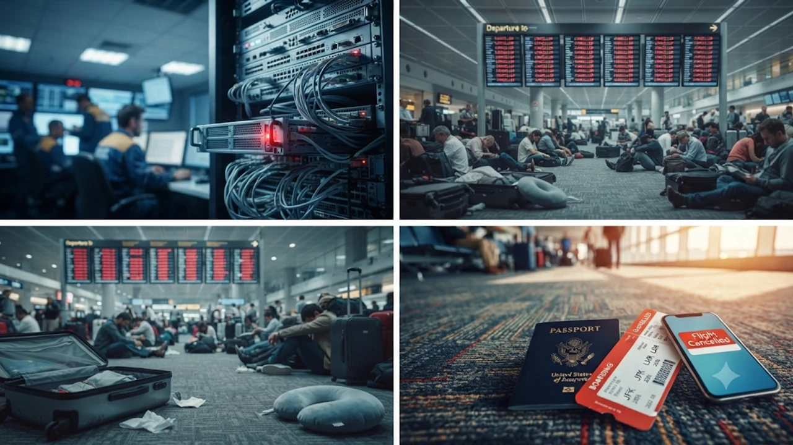

2026년 11월 발생한 미국 연방항공청(FAA) 관제통신 마비 사태는 전 세계 여행객의 발을 묶으며 엄청난 혼란을 낳았습니다. 미주 노선 경유 계획이 있다면 이번 미국 항공 대란 실태와 환불 대처법을 반드시 점검해야 합니다.

## 미국 항공 대란 전말과 발생 원인
### 관제통신 라우터 과부하로 사상 초유의 전면 이륙 중단 사태 발생
미국 연방항공청(FAA)의 핵심 관제통신 라우터 시스템에 예상치 못한 과부하가 걸리면서 전미 공항의 이륙이 전면 통제되는 초유의 사태가 벌어졌습니다. 시스템 오류 직후 실시간 운항 데이터 연동이 끊기면서 항공기 안전 운항을 담보할 수 없는 상태가 되어 전면 셧다운 조치가 내려졌습니다.

### 4시간 만의 운항 재개에도 누적 결항 1만 7천 편 육박한 이유
시스템 복구 작업이 신속하게 진행되어 수 시간 만에 운항 재개 승인이 떨어졌으나, 이미 꼬여버린 항공기 스케줄과 승무원 로테이션 문제로 인해 연쇄 결항이 걷잡을 수 없이 커졌습니다. 허브 공항에 대기하던 항공기들이 제때 제 자리를 찾지 못하면서 미국 전역은 물론 대서양 횡단 노선까지 마비되었습니다.

## 전 세계 환승객 및 미주 노선 여행객 직격탄
### 미국 경유 노선 및 유럽-미주 연결편 연쇄 지연 실태
미국 주요 공항을 경유하여 중남미나 캐나다, 혹은 유럽으로 향하려던 국내 여행객과 비즈니스 출장객들이 현지 공항에서 발이 묶이는 피해를 입었습니다. 환승 대기 시간이 촉박했던 승객들은 연결편을 놓쳤고, 대체 항공편 예약 대기열이 수천 명씩 쌓이는 악전고투가 벌어졌습니다. [세계여행지 최신 트렌드](/posts/world-travel/world-travel-1783348391782/) 글에서 글로벌 이동 시 발생할 수 있는 리스크 관리법도 함께 참고해 보길 바랍니다.

### 현지 공항 체류 및 대체 항공편 배정 과정의 혼란
공항 카운터 앞에는 환불과 재예약을 요구하는 승객들로 인산인해를 이루었고, 항공사 시스템이 마비되면서 모바일 앱과 현장 안내가 실시간으로 연동되지 않는 소통 부재가 혼란을 부추겼습니다. 노련한 여행객들은 즉시 자국 항공사 고객센터로 전화 연결을 시도해 현장 줄서기보다 빠르게 대체편을 확보하는 기지를 발휘했습니다.

## 항공권 취소·변경 및 환불·보상 받는 실전 가이드
### 미국 FAA 사태 시 적용되는 항공사별 보상 기준
자연재해나 국가 시스템 마비와 같은 불가항력적 요인으로 분류되더라도, 미국 교통부(DOT) 규정에 따라 항공기 운항이 전면 취소되거나 3시간 이상 지연된 경우 승객은 전액 현금 환불을 요구할 수 있습니다. 바우처 형태로 강제 적립하려는 항공사의 꼼수에 흔들리지 말고 원금 환급을 당당하게 요구해야 합니다.

### 무료 취소 및 일정 변경을 위한 골든타임 대처법
항공사 홈페이지나 예약 플랫폼의 셀프 서비스 메뉴를 통해 수수료 없는 자진 취소 가능 여부를 즉시 확인해야 합니다. 대기가 길어질 경우 한국어 상담 지원이 가능한 국내 총대리점이나 발권 대행사를 통해 신속하게 티켓 상태를 오픈(Open) 처리해 두는 것이 안전합니다.

## 앞으로의 미주 여행 대비 항공권 예약 꿀팁
### 환승 대기 시간 넉넉히 잡기 및 여행자보험 필수 체크 사항
이번 사태처럼 관제 시스템 결로나 공항 파업이 빈번한 시기에는 미주 환승 시 최소 3시간 이상의 여유를 두는 것이 철칙입니다. 또한 항공기 결항이나 지연으로 인한 숙박비, 대체 교통비를 실비로 보장해 주는 트래블 이즈 프리미엄 특약이 포함된 여행자보험 가입이 선택이 아닌 필수입니다.

### 실시간 운항 정보 확인하는 대표 사이트와 앱 활용법
항공사 알림만 믿고 기다리기보다 플라이트레이더24(Flightradar24)나 미 FAA 실시간 운항 현황 페이지를 직접 새로고침하며 비행기 위치를 추적하는 능동적인 자세가 필요합니다. 현장 안내 방송보다 앱 푸시 알림이 수 분 더 빠르게 뜨는 경우가 많으므로 스마트폰 네트워크 환경을 최상으로 유지해야 합니다.

[미국 여행 필수 준비물과 항공권 특가 상품을 비교해 보세요](https://www.coupang.com/np/search?q=%EC%97%AC%ED%96%89%EC%9A%A9%ED%92%88&sourceType=affiliate&trackingCode=AF8691300)

#미국항공대란 #FAA통신장애 #미국여행준비 #항공권환불 #미주노선결항 #해외여행팁 #미국항공권보상