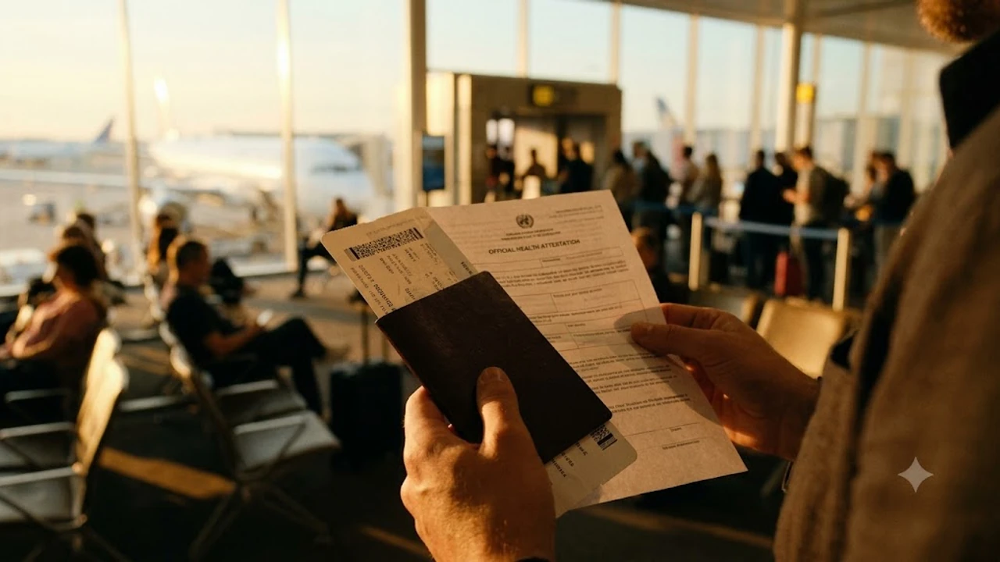

미국행 비행기에 오르기 전 체크인 카운터에서 탑승권을 받지 못해 발을 동동 구르는 승객들이 공항 곳곳에서 속출하고 있습니다. 미 질병통제예방센터(CDC)의 행정 명령 발령에 따라 미국으로 향하는 모든 항공편 탑승객을 대상으로 **미국 입국 규정**에 필수 검역 요건인 항공기 탑승객 서약서 제출이 전면 의무화되었습니다. 유효한 전자여행허가(ESTA)나 비자를 쥐고 있어도 검역 확인서를 누락하면 항공사 발권 시스템에서 탑승권 발급 자체가 막히므로 출국 전 철저한 사전 준비가 필수입니다.

## CDC 탑승객 건강확약서 의무화 배경과 적용 범위

### 글로벌 바이러스 확산 차단을 위한 보건 조치
이번 조치는 특정 고위험 감염병 발병국을 거쳐 미국 본토로 들어오는 전염 고리를 원천 차단하기 위한 연방 정부의 긴급 방역 행정명령입니다. 미국 보건복지부 산하 CDC는 국제공항을 통한 감염병 유입을 조기에 통제하고자 미국행 전 노선 항공사에 승객 검역 진술서 징구를 법적 의무 명령으로 하달했습니다.

### 국적과 비자 종류를 불문한 전면 적용
환승객을 포함해 미국 영토에 착륙하는 비행기에 오르는 탑승객 전원이 대상입니다. 대한민국 국적의 ESTA 단기 무비자 여행객은 물론 미국 시민권자, 영주권자, 학생비자(F-1), 주재원 및 취업비자(H-1B) 소지자도 예외 없이 확약서를 제출해야만 비행기 티켓을 손에 쥘 수 있습니다.

### 유아 및 미성년자 동반 탑승객의 대리 작성 기준
스스로 서류를 작성하기 어려운 만 17세 이하 미성년자나 거동이 불편한 승객은 법적 보호자 또는 부모가 대리 작성 후 서명할 수 있습니다. 가족 단위 여행객이라도 1인당 1부씩 개별 서명하는 방식이 원칙이며, 단 1명이라도 누락되면 일행 전체의 카운터 수속이 올스톱됩니다.

## 확약서 핵심 항목과 항공사 탑승 거부 기준

### 잠복기 위험 지역 체류 이력 확인
서약서의 핵심 질문은 비행기 탑승일 기준 최근 21일 이내에 CDC가 지정한 고위험 감염병 발병 국가나 특정 발병 지역을 방문, 체류, 단순 경유했는지 여부입니다. 인천국제공항 델타항공 및 대한항공 카운터에서는 현장 키오스크와 모바일 웹 체크인 단계에서 해당 문항을 필수 팝업으로 띄우고 있습니다.

### 발열 및 호흡기 증상 유무 자가 진단
체류 이력 외에도 최근 48시간 이내에 섭씨 38도 이상의 고열, 원인 불명의 오한, 구토, 설사, 비정상적 출혈 같은 증상이 나타났는지 직접 체크해야 합니다. 증상을 숨긴 채 허위로 체크했다가 미국 현지 입국장 열화상 카메라에 포착되면 즉시 2차 심층 인터뷰실(세컨더리 룸)로 격리 조치됩니다.

> **주의사항**
> 허위 진술 시 미국 연방 형법(18 U.S. Code § 1001)에 따라 최대 5년 이하의 징역형이나 무거운 벌금형에 처해질 수 있으며, 즉각적인 입국 불허와 영구 비자 취소 조치가 뒤따릅니다.

최근 입국 심사 강화 기조는 이전의 [미국 여행 입국 바뀐 규정 진짜 3가지](/posts/world-travel/us-travel-reentry-advance-parole-rule-change-2026/) 사례와 마찬가지로 서류상 사소한 불일치조차 용인하지 않는 엄격한 심사 추세를 그대로 보여줍니다.

## 현장 혼선을 피하는 온라인 및 모바일 사전 작성 절차

### 항공사 모바일 앱 사전 체크인 연동 방식
대한항공, 아시아나항공, 유나이티드항공 등 주요 항공사들은 공식 웹사이트와 앱의 웹 체크인 화면 안에 CDC 양식을 디지털 폼으로 심어두었습니다. 출발 24시간 전 열리는 모바일 체크인 과정에서 전자 서명을 끝내면 별도 종이 출력 없이 모바일 탑승권에 검역 승인 코드가 찍혀 나옵니다.

### 공항 현장 키오스크 및 지류 서약서 작성 요령
모바일 조작이 서툴러 웹 체크인을 건너뛴 승객은 공항 내 셀프 키오스크 화면에서 약 2~3분에 걸쳐 문항을 직접 눌러야 합니다. 키오스크 시스템 에러가 발생할 경우 체크인 카운터에서 영문 종이 서약서를 펜으로 작성해야 하므로 최소 비행 3시간 전 공항에 도착하는 동선이 안전합니다.

### 환승 및 공동운항(코드셰어) 이용 시 필수 점검사항
외항사를 경유해 미국으로 진입하는 환승객은 첫 출발 공항이 아니라 '미국으로 향하는 마지막 환승 공항' 게이트 앞에서 확약서를 재검증받게 됩니다. 공동운항편은 티켓을 결제한 항공사가 아닌 비행기를 직접 띄우는 실제 운항사(Operating Carrier) 시스템에 확약서가 등록되었는지 확인해야 환승 게이트 앞에서 발이 묶이지 않습니다.

## 미국 도착 후 공항 검역 절차와 여행자 대비 요령

### 입국심사대(CBP) 세컨더리 지정 및 격리 리스크 관리
미국 공항에 닿으면 세관국경보호국(CBP) 심사관이 전산에 올라온 확약서 내용을 바탕으로 불시 구두 질문을 던집니다. 서류에 기재한 내용과 말로 답한 내용이 어긋나거나 위험 지역 방문 사실을 숨긴 낌새가 포착되면 곧각 정밀 조사 대상자로 지정되어 장시간 격리 검사를 받게 됩니다.

### 기내 및 대기 시간 대비 개인 방역 물품 준비
비행기 객실과 붐비는 입국장 대기 줄은 호흡기 질환 감염에 가장 취약한 공간입니다. 갑작스러운 발열이나 컨디션 난조는 검역관의 불필요한 의심을 사는 지름길이므로, 기내에서 착용할 마스크와 소독 티슈, 체온계 등을 휴대 가방에 챙겨두는 편이 유리합니다. 장거리 비행 중 휴대 규격을 만족하는 방역 용품이나 수납 파우치는 출국 전 미리 구비해두면 입국장에서 유용하게 쓰입니다.

[여행용품 파우치 및 방역 키트 쿠팡에서 보기](https://www.coupang.com/np/search?q=%EC%97%AC%ED%96%89%EC%9A%A9%ED%92%88%ED%8C%8C%EC%9A%B0%EC%89%90&sourceType=affiliate&trackingCode=AF8691300)

### 비상 상황 대비 영문 처방전 및 진단서 지참
지병으로 평소 체온이 다소 높거나 복용 중인 약이 있다면 담당의의 영문 진단서나 처방전을 휴대 수하물에 넣어두어야 합니다. 단순 미열이나 비염 증상이라도 현장 검역관이 문제 삼을 때 공인된 영문 소견서를 보여주면 억류나 불필요한 역학조사를 빠르게 면할 수 있습니다.

#미국입국규정 #CDC서약서 #미국건강확약서 #미국여행주의사항 #미국항공권체크인 #미국입국심사 #미국ESTA입국